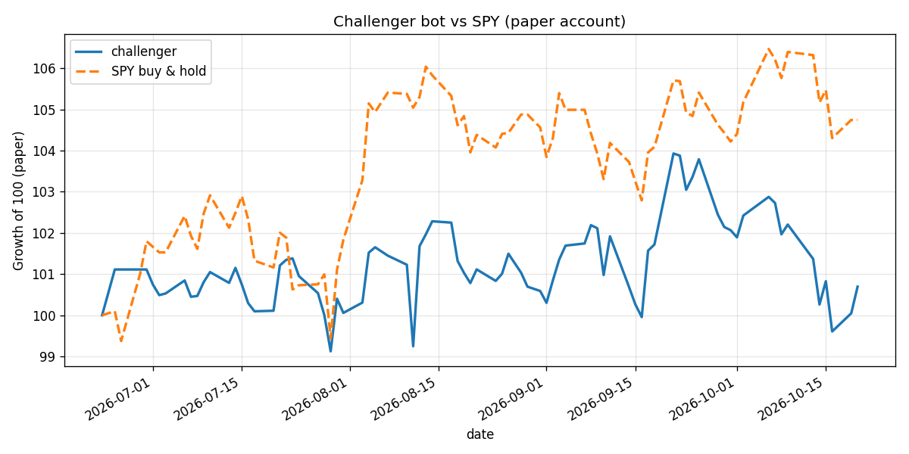

# Challenger bot vs SPY (paper account)

_Last updated: 2026-10-19 23:03 UTC · live for 118 days · equity $100,047_

| Metric | challenger | SPY |
|---|---|---|
| Total return | +0.05% | +4.30% |
| Excess vs SPY | -4.26% | — |
| Max drawdown | -4.16% | — |
| Sharpe (since inception) | 0.07 | — |

Reminder: these strategies trail the index for months at a time even when working. Judge on 3-6 months minimum, not weeks.
