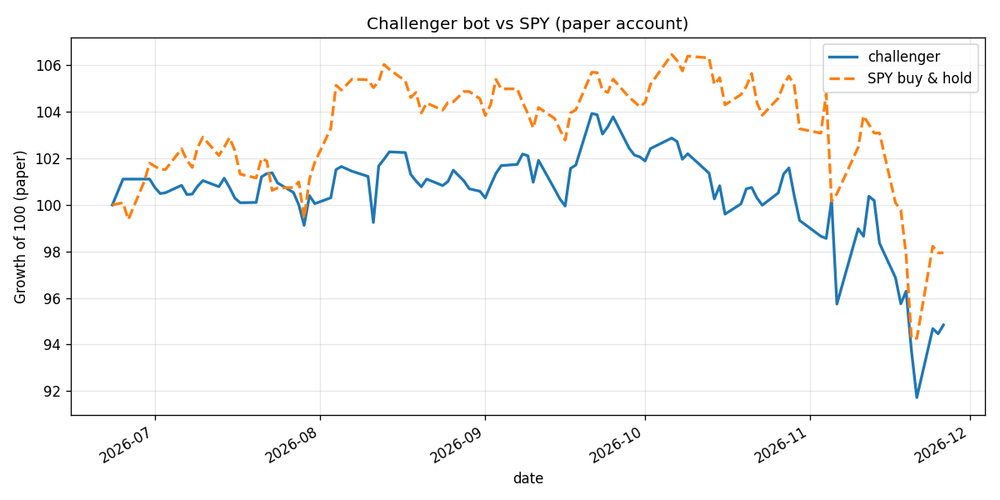

# Challenger bot vs SPY (paper account)

_Last updated: 2026-11-26 02:24 UTC · live for 156 days · equity $94,841_

| Metric | challenger | SPY |
|---|---|---|
| Total return | -5.16% | -2.06% |
| Excess vs SPY | -3.10% | — |
| Max drawdown | -11.75% | — |
| Sharpe (since inception) | -0.69 | — |

Reminder: these strategies trail the index for months at a time even when working. Judge on 3-6 months minimum, not weeks.
