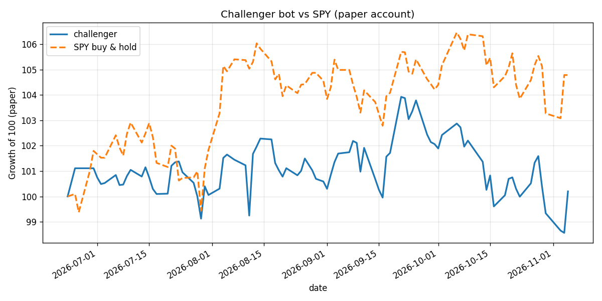

# Challenger bot vs SPY (paper account)

_Last updated: 2026-11-13 00:39 UTC · live for 143 days · equity $100,187_

| Metric | challenger | SPY |
|---|---|---|
| Total return | +0.19% | +3.47% |
| Excess vs SPY | -3.28% | — |
| Max drawdown | -7.88% | — |
| Sharpe (since inception) | 0.11 | — |

Reminder: these strategies trail the index for months at a time even when working. Judge on 3-6 months minimum, not weeks.
