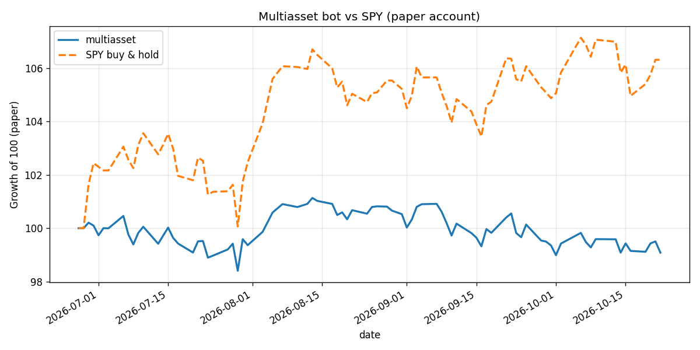

# Multiasset bot vs SPY (paper account)

_Last updated: 2026-10-13 23:24 UTC · live for 108 days · equity $99,585_

| Metric | multiasset | SPY |
|---|---|---|
| Total return | -0.42% | +7.00% |
| Excess vs SPY | -7.42% | — |
| Max drawdown | -2.12% | — |
| Sharpe (since inception) | -0.20 | — |

Reminder: these strategies trail the index for months at a time even when working. Judge on 3-6 months minimum, not weeks.
