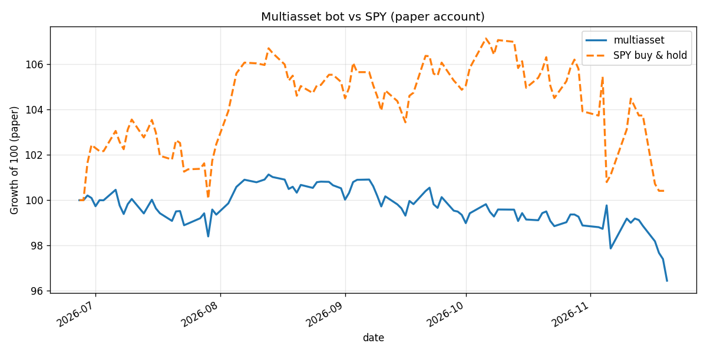

# Multiasset bot vs SPY (paper account)

_Last updated: 2026-11-19 01:26 UTC · live for 145 days · equity $97,403_

| Metric | multiasset | SPY |
|---|---|---|
| Total return | -2.60% | +0.72% |
| Excess vs SPY | -3.32% | — |
| Max drawdown | -3.69% | — |
| Sharpe (since inception) | -0.91 | — |

Reminder: these strategies trail the index for months at a time even when working. Judge on 3-6 months minimum, not weeks.
