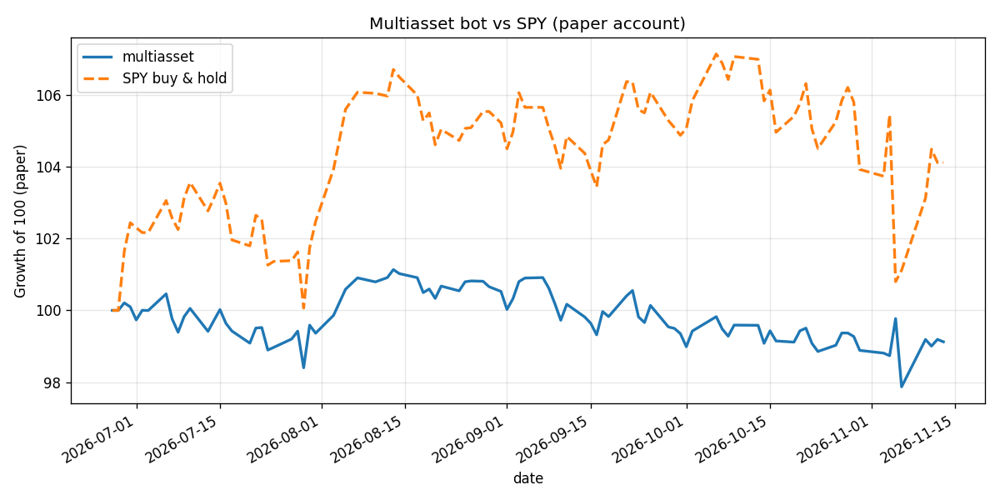

# Multiasset bot vs SPY (paper account)

_Last updated: 2026-11-06 23:48 UTC · live for 132 days · equity $97,872_

| Metric | multiasset | SPY |
|---|---|---|
| Total return | -2.13% | +0.80% |
| Excess vs SPY | -2.93% | — |
| Max drawdown | -3.23% | — |
| Sharpe (since inception) | -0.83 | — |

Reminder: these strategies trail the index for months at a time even when working. Judge on 3-6 months minimum, not weeks.
